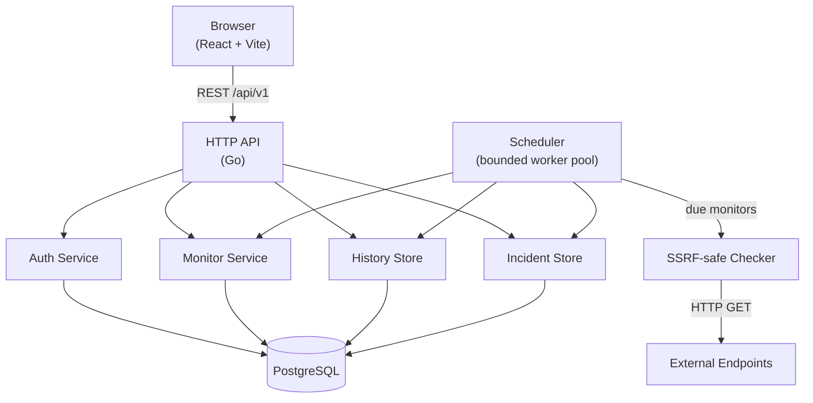

# ServiceWatch

> **Reference Only — All Rights Reserved**
>
> This repository is publicly available for portfolio presentation and technical evaluation only. Public visibility does not grant permission to deploy, operate, commercially use, modify, redistribute, or create derivative works from this software. Any additional use requires prior written authorization under the applicable license and subject to applicable law. All rights not expressly granted are reserved.
>
> See [LICENSE](LICENSE). To request permission for additional use, contact majeed.developer0@gmail.com.

A professional, self-hosted uptime monitoring platform built with Go and React. Register HTTP/HTTPS endpoints, receive periodic health checks, and review historical availability and response times through a clean developer-focused dashboard.

> **Portfolio project** — demonstrates production-grade Go backend engineering, a React/TypeScript frontend, and security-conscious system design.

---

## Features

- **Endpoint monitoring** — HTTP/HTTPS checks at 1/5/10/30/60-minute intervals
- **SSRF-safe outbound requests** — custom dialer validates resolved IP addresses before connecting
- **Bounded worker pool** — configurable concurrency; no unbounded goroutine creation
- **JWT authentication** — register, log in, manage your profile and password
- **Monitor management** — create, edit, pause/resume, delete with ownership isolation
- **Check history** — paginated results, availability percentage (24h/7d), response-time chart
- **Incident tracking** — automatic incident open/resolve lifecycle
- **Dashboard** — real-time stats, recent failures, and recent incidents
- **Graceful shutdown** — in-flight checks complete before the process exits
- **GitHub Actions CI** — format check, vet, tests, type-check, build

---

## Screenshots

> _Screenshots will be added after the application is running against live data._

---

## Architecture



---

## Technology Stack

| Layer | Technology |
|---|---|
| Backend language | Go 1.23+ |
| HTTP router | `julienschmidt/httprouter` |
| Database | PostgreSQL 17+ |
| DB driver | `pgx/v5` with connection pool |
| Auth | JWT (HS256) via `golang-jwt/jwt/v5` |
| Password hashing | bcrypt (cost 12) |
| Frontend | React 19 + TypeScript |
| Build tool | Vite 8 |
| Routing | React Router v7 |
| Data fetching | TanStack Query v5 |
| Forms | React Hook Form + Zod |
| Styling | Tailwind CSS v4 |
| Charts | Recharts v3 |
| Testing (Go) | `go test` + `httptest` |
| Testing (FE) | Vitest + Testing Library |
| CI | GitHub Actions |

---

## Repository Structure

```
ServiceWatch/
├── cmd/
│   └── server/          # Application entry point
├── internal/
│   ├── auth/            # JWT issuance, bcrypt hashing, user service + store
│   ├── checker/         # SSRF-safe HTTP checker and transport
│   ├── config/          # Environment-variable configuration
│   ├── history/         # Check history persistence and availability calc
│   ├── http/
│   │   ├── handlers/    # HTTP request handlers (auth, monitors, history, …)
│   │   └── middleware/  # Auth, CORS, logging middleware
│   ├── incident/        # Incident open/resolve lifecycle
│   ├── monitor/         # Monitor domain model, service, validation
│   ├── scheduler/       # Bounded worker pool and scheduling loop
│   └── storage/         # PostgreSQL connection pool factory
├── migrations/          # Versioned SQL migrations
├── frontend/            # React/TypeScript application
│   └── src/
│       ├── api/         # Typed API client
│       ├── components/  # Reusable UI components
│       ├── hooks/       # React hooks
│       ├── pages/       # Page components
│       ├── test/        # Vitest test files
│       ├── types/       # Shared TypeScript types
│       └── utils/       # Time/format utilities
├── docs/                # Architecture and technical docs
├── .github/workflows/   # GitHub Actions CI
├── docker-compose.yml   # PostgreSQL for local development
├── .env.example         # Environment variable reference
└── go.mod
```

---

## Prerequisites

- Go 1.23+
- Node.js 22+ and npm
- PostgreSQL 15+ (or Docker for a quick local setup)

---

## Quick Start

### 1. Clone and configure

```bash
git clone https://github.com/amsoft/servicewatch.git
cd servicewatch
cp .env.example .env
# Edit .env — set JWT_SECRET, DB_PASSWORD at minimum
```

### 2. Start PostgreSQL

**With Docker Compose:**
```bash
docker compose up -d postgres
```

**Or with an existing PostgreSQL installation:**
```sql
-- run as postgres superuser
CREATE USER servicewatch WITH PASSWORD 'changeme';
CREATE DATABASE servicewatch OWNER servicewatch;
```

### 3. Run migrations

```bash
# Using psql
psql "$DATABASE_URL" -f migrations/001_initial_schema.sql
# Optionally load development seed data
psql "$DATABASE_URL" -f migrations/002_seed_data.sql
```

If `DATABASE_URL` is not set, construct it from your `.env` values:
```bash
export DATABASE_URL="host=localhost port=5432 user=servicewatch password=changeme dbname=servicewatch sslmode=disable"
```

### 4. Start the backend

```bash
# Load .env (Linux/macOS)
export $(grep -v '^#' .env | xargs)

# Windows PowerShell
Get-Content .env | Where-Object { $_ -notmatch '^#' -and $_ -ne '' } | ForEach-Object {
    $parts = $_ -split '=', 2; [System.Environment]::SetEnvironmentVariable($parts[0], $parts[1])
}

go run ./cmd/server
```

The server starts on `http://localhost:8080` by default.

### 5. Start the frontend

```bash
cd frontend
npm install --legacy-peer-deps
npm run dev
```

Open `http://localhost:5173` in your browser.

---

## Health Endpoints

| Endpoint | Description |
|---|---|
| `GET /health/live` | Liveness — 200 if the process is running |
| `GET /health/ready` | Readiness — 200 if the database is reachable |

---

## API Reference

All API endpoints are under `/api/v1`. See [docs/API.md](docs/API.md) for full documentation.

### Authentication

| Method | Path | Description |
|---|---|---|
| POST | `/api/v1/auth/register` | Create account |
| POST | `/api/v1/auth/login` | Authenticate |
| GET | `/api/v1/auth/me` | Current user |
| PATCH | `/api/v1/auth/me` | Update profile |
| POST | `/api/v1/auth/change-password` | Change password |

### Monitors

| Method | Path | Description |
|---|---|---|
| GET | `/api/v1/monitors` | List monitors (paginated) |
| POST | `/api/v1/monitors` | Create monitor |
| GET | `/api/v1/monitors/:id` | Get monitor |
| PUT | `/api/v1/monitors/:id` | Update monitor |
| DELETE | `/api/v1/monitors/:id` | Delete monitor |
| POST | `/api/v1/monitors/:id/pause` | Pause |
| POST | `/api/v1/monitors/:id/resume` | Resume |

### History & Analytics

| Method | Path | Description |
|---|---|---|
| GET | `/api/v1/monitors/:id/checks` | Check history |
| GET | `/api/v1/monitors/:id/availability` | Availability % |
| GET | `/api/v1/monitors/:id/response-times` | Response time series |
| GET | `/api/v1/monitors/:id/incidents` | Incident history |
| GET | `/api/v1/dashboard` | Dashboard stats |

---

## Configuration Reference

All configuration is via environment variables. See [`.env.example`](.env.example) for the full list.

| Variable | Default | Description |
|---|---|---|
| `PORT` | `8080` | HTTP listen port |
| `DATABASE_URL` | — | Full PostgreSQL DSN (overrides `DB_*`) |
| `JWT_SECRET` | **required** | ≥32-char signing key |
| `JWT_EXPIRY` | `24h` | Token lifetime |
| `BCRYPT_COST` | `12` | bcrypt work factor |
| `MONITOR_WORKER_COUNT` | `10` | Max concurrent checks |
| `MONITOR_SCHEDULER_INTERVAL` | `30s` | How often the scheduler polls |
| `MONITOR_ALLOW_PRIVATE_IPS` | `false` | Dev-only: allow loopback/private targets |
| `CORS_ORIGINS` | `http://localhost:5173` | Comma-separated allowed origins |

---

## Check Intervals

Supported check intervals: **1 min**, **5 min**, **10 min**, **30 min**, **1 hour**.

Default: 5 minutes. Default request timeout: 30 seconds (5–120 s range).

---

## SSRF Security

ServiceWatch makes outbound HTTP requests to user-supplied URLs. See [docs/SECURITY.md](docs/SECURITY.md) for the full threat model and mitigations. Key controls:

- Custom dialer resolves the hostname and validates each IP before connecting.
- Loopback, link-local (including `169.254.169.254`), private, multicast, and unspecified addresses are blocked.
- Redirects are disabled by default (unexpected redirects are treated as failures).
- Response-body reads are bounded at 1 MiB.
- Credentials embedded in URLs are rejected at validation time.
- `MONITOR_ALLOW_PRIVATE_IPS=true` exists for local development only and must never be set in production.

---

## Testing

```bash
# Go unit tests (checker, auth, monitor validation)
go test ./... -count=1

# Go tests with race detector
go test ./... -race -count=1

# Frontend tests
cd frontend && npm test

# Frontend type check
cd frontend && npm run typecheck

# Frontend production build
cd frontend && npm run build
```

### Test results (recorded 2026-10-29)

```
go vet ./...                        PASS (no issues)
gofmt -l ./cmd ./internal           PASS (all files formatted)
go test ./internal/auth/...         PASS (13 tests)
go test ./internal/checker/...      PASS (18 tests, includes SSRF blocks)
go test ./internal/monitor/...      PASS (10 tests)
Frontend: vitest run                PASS (15 tests)
Frontend: tsc --noEmit              PASS
Frontend: vite build                PASS (815 KB bundle)
```

---

## Availability Calculation

Availability is the percentage of successful checks in the selected time window:

```
availability = (successful_checks / total_checks) * 100
```

Time windows with no recorded checks report `0%` availability and `0/0` checks. The calculation uses actual recorded checks, not calendar time.

---

## Monitoring History Retention

Check history is retained indefinitely in the current implementation. A pruning strategy (e.g., `DELETE FROM monitor_checks WHERE checked_at < NOW() - INTERVAL '90 days'`) can be scheduled externally. See [docs/DATABASE.md](docs/DATABASE.md) for guidance.

---

## Deployment

> **Reference only:** the guidance below documents how the system is designed to run. Deploying or operating this software requires prior written authorization under the [LICENSE](LICENSE).

See [docs/DEPLOYMENT.md](docs/DEPLOYMENT.md) for production deployment guidance including reverse proxy setup, TLS termination, and environment hardening.

---

## Known Limitations

- Single-process scheduler — not suitable for multi-instance deployments without distributed locking.
- DNS rebinding: the custom dialer mitigates but does not fully eliminate this risk. Network-level egress controls are recommended in production.
- No email/webhook alerting in this version.
- No Playwright end-to-end tests yet (integration tests require a test database setup).
- The frontend bundle is not code-split (one 816 KB JS chunk); code-splitting would be a straightforward improvement.

---

## Roadmap

- [ ] Webhook and email alerting on monitor state change
- [ ] Playwright end-to-end test suite
- [ ] Code-split frontend bundle
- [ ] Prometheus metrics endpoint
- [ ] Docker multi-stage build and Dockerfile
- [ ] Multi-process scheduler with advisory locking

---

## Contributing

This project is published for reference and portfolio evaluation and is not open to outside contributions or pull requests. See [LICENSE](LICENSE) for the use that is permitted, and contact me to request any additional permission.

## License

Copyright (c) 2026 Abdul Majeed. All rights reserved.

This project is published under a custom **Reference-Only Source-Available License**. It is **not** an open-source license. See [LICENSE](LICENSE). Deployment, commercial use, modification and redistribution require prior written authorization. Permission requests: majeed.developer0@gmail.com

